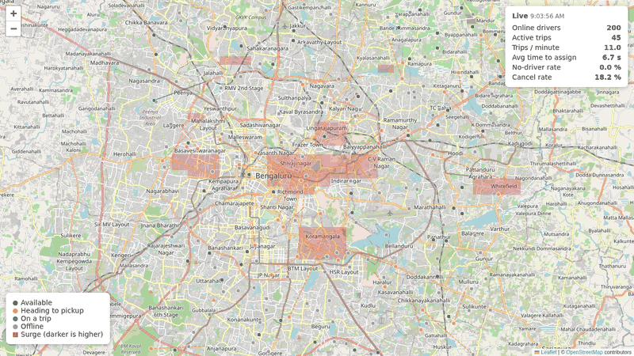
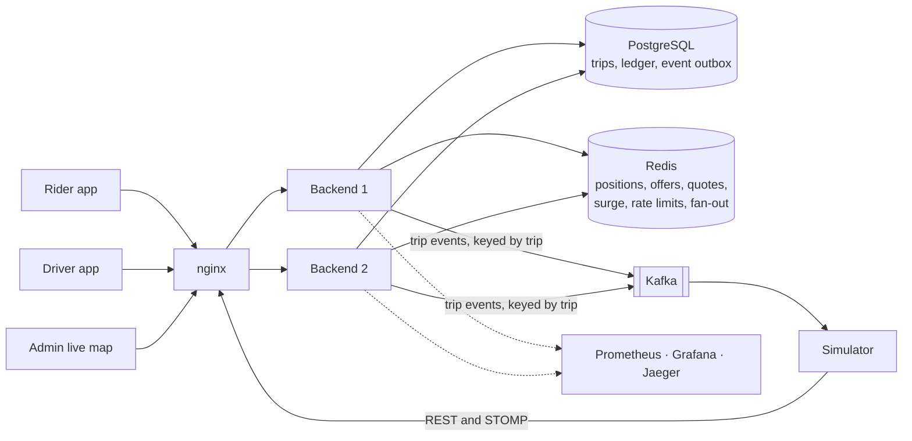

# RideFlow

**The backend of a ride-hailing service - a booking reaches the nearest driver in milliseconds,
money moves through a double-entry ledger - built as a Spring Boot modular monolith and load-tested
with 2,000 simulated drivers.**



Riders get fare quotes, book, follow their driver live, pay from a wallet and rate the trip.
Drivers onboard, go online, stream their position, accept offers and complete trips. Admins approve
drivers, watch the live map and steer surge pricing. A simulator drives all of it through the
public API, and one command starts the whole system.

Java 21 · Spring Boot 4 · Spring Modulith · PostgreSQL 17 · Redis 7 · Kafka (KRaft) · STOMP over
WebSocket · Testcontainers · Prometheus, Grafana, OpenTelemetry · k6 · GitHub Actions

## Architecture



One deployable backend, split into modules whose boundaries Spring Modulith verifies on every
build. A module calls another only through its public package, and reacts to it through events
([ADR 0001](docs/adr/0001-modular-monolith.md)).

| Module | Responsibility |
|---|---|
| `identity` | Registration, login, JWT access tokens, refresh-token families |
| `driver` | Driver profile, vehicle, approval, status, ratings |
| `location` | Positions over STOMP, Redis GEO, stale-driver sweep, nearby search |
| `pricing` | Rate cards, route estimates, fare quotes, surge engine |
| `trip` | Trip state machine, idempotent booking, OTP, final fare |
| `matching` | Candidate search, offers, timeouts, crash recovery |
| `payment` | Wallets, double-entry ledger, top-ups, charges, refunds |
| `rating` | Rider and driver ratings |
| `notification` | Real-time push to users on any instance |
| `admin` | Admin APIs and the live map |
| `shared` | Money, geo types, ids, error model, rate limits |

## Engineering highlights

Each links to the code, and to the test that proves it.

- **Zero double assignment.**
  - **Guards:** two partial unique indexes make a second active trip per rider or per driver
    impossible in PostgreSQL itself ([V7](backend/src/main/resources/db/migration/V7__trips.sql#L72)).
    A Redis lock gives each driver one live offer at a time
    ([offer_create.lua](backend/src/main/resources/redis/offer_create.lua)).
  - **Proof:** a hundred riders booking at once against ten drivers make exactly ten trips, and no
    driver holds two ([test](backend/src/test/java/com/rideflow/matching/internal/MatchingIntegrationTest.java#L758)).
    After every load run: 0 overlapping assignments across 8,536 trips.
- **Non-blocking, crash-safe matching.** No thread waits for a driver to answer.
  - **How:** offers, locks and deadlines live in Redis. A poller on every instance claims due offers
    with an atomic `ZREM` ([OfferPoller](backend/src/main/java/com/rideflow/matching/internal/OfferPoller.java)),
    and a sweep rebuilds lost matches from PostgreSQL
    ([RecoverySweeper](backend/src/main/java/com/rideflow/matching/internal/RecoverySweeper.java)).
  - **Proof:** a chaos test kills the backend mid-matching, and the trip is still assigned
    ([test](simulator/src/test/java/com/rideflow/simulator/FullStackChaos.java#L247)).
- **Transactional outbox.**
  - **How:** each event is stored in the Spring Modulith publication registry in the transaction that
    changes the state, delivered after commit, and copied to Kafka keyed by trip
    ([externalization](backend/src/main/java/com/rideflow/trip/internal/TripEventExternalization.java),
    [redelivery](backend/src/main/java/com/rideflow/shared/internal/EventRedelivery.java)).
  - **Proof:** Kafka stopped for 60 s while trips complete: 76 of 76 events arrive
    ([test](simulator/src/test/java/com/rideflow/simulator/FullStackChaos.java#L165)).
- **Double-entry ledger, property-tested.**
  - **How:** database triggers refuse an unbalanced or edited entry
    ([V11](backend/src/main/resources/db/migration/V11__ledger.sql#L86)).
  - **Proof:** a property test drives 40 random sequences of 30 operations - top-ups, charges, fees,
    refunds, redeliveries - through the real services. Every transaction balances, and all balances
    sum to zero ([test](backend/src/test/java/com/rideflow/payment/internal/LedgerInvariantsTest.java#L48)).
  - **Why seeded:** jqwik does not yet run on JUnit 6 ([ADR 0003](docs/adr/0003-test-stack-on-junit-6-jqwik-deferred.md)).
- **Multi-instance WebSocket fan-out.**
  - **How:** each instance delivers only to its own sessions, and messages cross instances through
    Redis Pub/Sub, so a plain round-robin balancer works for any number of instances
    ([publisher](backend/src/main/java/com/rideflow/notification/internal/RedisRealtimePublisher.java),
    [delivery](backend/src/main/java/com/rideflow/notification/internal/LocalDelivery.java)).
  - **Proof:** [test](backend/src/test/java/com/rideflow/notification/internal/RealtimeDeliveryIntegrationTest.java#L178).
- **Surge smoothing.**
  - **How:** demand against supply in each geohash cell sets a target multiplier, and the price moves
    one step per tick towards it, so fares never jump
    ([calculator](backend/src/main/java/com/rideflow/pricing/internal/SurgeCalculator.java)).
  - **Proof:** [test](backend/src/test/java/com/rideflow/pricing/internal/SurgeCalculatorTest.java#L83).
    Two instances ticking at the same moment step once
    ([test](backend/src/test/java/com/rideflow/pricing/internal/SurgeIntegrationTest.java#L242)).

## Measured performance

The targets of [PROJECT_SPEC](PROJECT_SPEC.md) section 2, measured on one laptop (Intel
i7-13650HX, 16 GB) running k6, the backend and every store together. Server-side figures, from
Prometheus. Every run, raw output and caveat is in [docs/performance.md](docs/performance.md).

| Metric | Target | Measured |
|---|---|---|
| Simulated online drivers | 2,000 (≈ 670 updates/s) | 2,000 connected; 666.5 updates/s, all accepted |
| Location ingest latency | p95 < 20 ms | **p95 2.8 ms** |
| Nearby-driver search | p95 < 10 ms | **p95 2.5 ms**, over a 30-minute soak |
| Booking (`POST /trips`) | p95 < 150 ms | **p95 16.6 ms** |
| Booking to first offer | p95 < 500 ms | **p95 17.8 ms** with drivers nearby; **missed** (11.0 s) when 200 bookings outran the cars |
| Double-assigned drivers | 0 | **0** across 8,536 assigned trips |
| Lost events, Kafka down | 0 | **0**: 76 of 76 with Kafka stopped for 60 s |
| Ledger balance | always 0 | **0** across 25,176 entries |

## Run it

With Docker (about 8 GB for it), one command starts PostgreSQL, Redis, Kafka, two backend
instances behind nginx, the simulator, Prometheus, Grafana and Jaeger:

```bash
docker compose -f infra/docker-compose.yml -f infra/docker-compose.scale.yml up
```

When everything is healthy it prints where to look:

| What | Where |
|---|---|
| Live map | http://localhost:8080/admin/live-map.html, with the admin login it prints |
| Swagger UI | http://localhost:8080/swagger-ui.html |
| Grafana dashboards | http://localhost:3000 |
| Traces | http://localhost:16686 |

The secrets the two instances share are generated on first start and never committed
([ADR 0018](docs/adr/0018-packaging-and-delivery.md)). Images are published to the GitHub Container
Registry from `main`.

## The web app

The rider and driver app lives in [`Frontend/`](Frontend/): React and strict TypeScript, typed end to
end against the backend's OpenAPI document, built phone first to Apple's design principles
([ADR 0019](docs/adr/0019-web-client.md)). With the demo running:

```bash
cd Frontend && npm ci && npm run dev    # http://localhost:5173
```

A rider signs in, chooses a pickup and a drop by search or on the map, sees the backend's own
prices, books once however often they tap, follows their driver on the map to the fare, rates
the ride, and tops up their wallet. A driver onboards, waits for approval, goes online, takes
offers, drives the trip on the map - arrival, the rider's code, the drop - rates the rider, and sees
what they earned. Both keep a list of their trips. REST stays the source of
truth; the live connection only hurries it along ([ADRs 0020 to 0027](docs/adr/)).

## Test it

```bash
./mvnw verify            # unit and integration tests on real PostgreSQL, Redis and Kafka; coverage gate
./mvnw -Pe2e verify      # the whole stack in containers, the backend as a black box
./mvnw -Pchaos verify    # Redis paused, Kafka stopped, the backend killed mid-matching
cd Frontend && npm test  # the web app: Vitest, Testing Library, MSW, and a fake /ws
```

CI runs build, unit tests, integration tests, the coverage gate and the image builds on every push,
and the end-to-end, chaos and demo runs every night.

## Read more

- [PROJECT_SPEC.md](PROJECT_SPEC.md): scope, architecture, domain rules, standards
- [Architecture decisions](docs/adr/): twenty-seven ADRs, from the modular monolith to the finished
  web app
- [Event catalog](docs/events.md) · [Runbook](docs/runbook.md) · [Security review](docs/security.md)
- [Performance](docs/performance.md) · [Deployment](docs/deploy.md) · [Development](docs/development.md)
