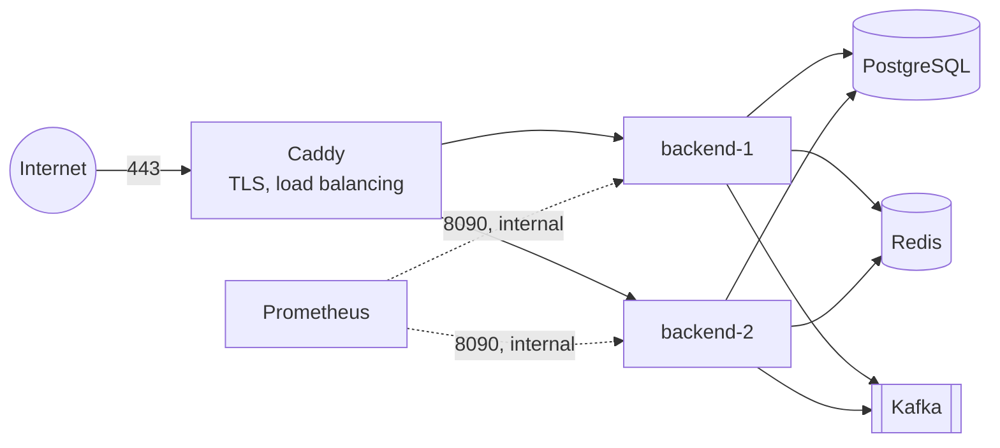

# Deploying RideFlow on one cloud VM

How to run the whole system on a single virtual machine with Docker Compose, behind HTTPS. It suits a
staging environment, a demo with real users, or a first production. The one-command demo in the
[README](../README.md) is not this: it runs the `sim` profile, with the per-address limits off and a
mock gateway that credits any wallet.

> **Rehearsed every night.** The files this guide uses live in [`infra/deploy/`](../infra/deploy/),
> and the nightly workflow ([`nightly.yml`](../.github/workflows/nightly.yml), job `vm`) runs them
> as they are on a fresh Ubuntu VM. It checks that HTTPS works and plain HTTP redirects, that the
> first admin can sign in, that only Caddy is published, that Prometheus scrapes both backends, and
> that an upgrade one instance at a time drops no request. What CI cannot do is a public DNS name
> and a Let's Encrypt certificate: it serves `localhost` from Caddy's local CA instead.

## What you get



- **Public:** only ports 80 and 443, both on Caddy. It obtains and renews a Let's Encrypt certificate
  on its own, and spreads requests and WebSockets over the two backends.
- **Internal:** PostgreSQL, Redis, Kafka, Prometheus and the backends' actuator port, 8090, are on
  the Compose network only. Grafana is on the VM's loopback, for an SSH tunnel.
- **Why Caddy talks to the backends directly:** behind an nginx in between, the backend would see
  nginx's plain-HTTP port and refuse the live map's WebSocket as another site's. Caddy passes
  `X-Forwarded-Proto: https`, which Tomcat believes because Caddy's address is private.

## Sizing

Measured on a laptop with 14 cores ([performance.md](performance.md)): 2,000 drivers streaming
positions used about 4% of its CPU, and a 30-minute soak at 60 bookings a minute stayed near 3%. A
VM with 4 vCPUs and 8 GB of memory runs everything in this guide with room to spare. 16 GB is
needed only if Prometheus keeps months of data.

## 1. The machine

```bash
# Ubuntu 24.04, as a user with sudo
curl -fsSL https://get.docker.com | sh
sudo usermod -aG docker "$USER"            # log out and in again
sudo ufw allow OpenSSH && sudo ufw allow 80,443/tcp && sudo ufw enable
git clone https://github.com/Ayushraj06-bit/TripEngine.git && cd TripEngine
```

Point a DNS name, say `rideflow.example.com`, at the VM before starting Caddy: Let's Encrypt
checks it.

## 2. Secrets

Never in the repository, never in the Compose file. One file per variable, which the applications
import as a Spring config tree ([ADR 0018](adr/0018-packaging-and-delivery.md)):

```bash
sudo infra/deploy/generate-secrets.sh          # into /etc/rideflow/secrets
```

- **What it makes:** the token signing key pair, the payment webhook secret, the database password,
  the first admin's password and Grafana's.
- **Who can read them:** root and group 10001 - the user the backend image runs as, and the group
  Grafana is given. Nobody else. (Readable by root alone, the backend could not start.)
- **Running it again:** safe. An existing secret is never replaced.

The signing key is the one secret whose loss logs everyone out: back it up with the database.

## 3. Configuration

```bash
cp infra/deploy/.env.example infra/deploy/.env   # then fill in the domain and the admin's phone
```

| Variable, in `infra/deploy/.env` | Value |
|---|---|
| `RIDEFLOW_DOMAIN` | the DNS name: Caddy's certificate, and the tokens' issuer |
| `RIDEFLOW_ADMIN_PHONE` | the first admin's phone; created on the first start, with the password file |
| `RIDEFLOW_IMAGE` | optional: another tag than `phase-11` |
| `RIDEFLOW_SECRETS` | optional: another directory than `/etc/rideflow/secrets` |

[`compose.yml`](../infra/deploy/compose.yml) sets the rest:

| Backend variable | Value |
|---|---|
| `SPRING_PROFILES_ACTIVE` | `prod`: JSON logs, Swagger off, and a refusal to start alongside `sim` |
| `SPRING_CONFIG_IMPORT` | `configtree:/run/rideflow/` (the secrets above) |
| `RIDEFLOW_DB_URL`, `RIDEFLOW_REDIS_HOST`, `RIDEFLOW_KAFKA_BOOTSTRAP` | the services on the Compose network |
| `RIDEFLOW_MANAGEMENT_PORT` | `8090`: actuator, scraped by Prometheus, never published |
| `RIDEFLOW_OTLP_ENDPOINT`, `RIDEFLOW_TRACE_SAMPLE` | add them for a trace collector; `0.1` samples one request in ten |

Payments: the gateway is a mock, because PROJECT_SPEC section 1 puts a real one out of scope.
- **What `prod` does:** keeps the mock's payment page off. A top-up is still created, but nothing
  can pay it, so it stays PENDING.
- **Until a real `PaymentGateway` replaces the mock:** riders pay cash.

## 4. Start

The images are private: `docker login ghcr.io` with a token that can read packages, then:

```bash
docker compose -f infra/deploy/compose.yml up -d --wait
```

- **[`Caddyfile`](../infra/deploy/Caddyfile):** HTTPS for the domain, plain HTTP redirected. Each
  backend is health-checked on `/readyz` every two seconds, and a request that reaches one just as
  it stops is retried on the other.
- **Redis keeps no backups on purpose:** positions, offers and quotes are minutes old by nature, and
  rebuild themselves from the drivers' next reports and PostgreSQL.
- **Logs:** Docker's `local` driver, which bounds them on disk.

## 5. Operating it

- **Upgrades:** set the new tag in `RIDEFLOW_IMAGE`, then replace one instance at a time, so the
  other keeps serving. CI rehearses exactly this and counts the requests dropped: none.
  - **Commands:** `docker compose -f infra/deploy/compose.yml up -d --no-deps --wait backend-1`,
    then the same for `backend-2`. `--wait` returns once the instance answers `/readyz`.
  - **In-flight work:** each instance gets 40 s to stop: 20 s for its requests, then 15 s for event
    listeners.
  - **Migrations:** Flyway runs them on start. Keep them backward compatible, since for a moment
    the old version runs against the new schema.
- **Backups:** `pg_dump` nightly, copied off the machine, and a restore tried now and then. The
  ledger is the record of everyone's money.
- **Monitoring:** Prometheus loads `infra/prometheus/alerts.yml`, and Grafana its dashboards.
  - **Access:** `ssh -L 3000:localhost:3000 the-vm`, then http://localhost:3000 as `admin`, with
    the password in `/etc/rideflow/secrets/GRAFANA_ADMIN_PASSWORD`.
  - **When an alert fires:** [the runbook](runbook.md).
- **Logs:** JSON on standard output, with the trace id in each line.

## Kubernetes

[`infra/k8s/backend.yaml`](../infra/k8s/backend.yaml) holds the backend's manifests:
- two replicas with startup, liveness and readiness probes, resource requests and a memory limit
- non-root, a read-only root filesystem, no capabilities
- a 5 s pause before shutdown, so the Service stops routing to a pod before it stops serving
- a disruption budget, and a horizontal autoscaler on CPU
- PostgreSQL, Redis and Kafka assumed managed, outside the cluster

**Run every night on a real cluster** (nightly job `kubernetes`): kind, with the stores inside it
([`infra/k8s/kind/`](../infra/k8s/kind/)) and the manifests otherwise unchanged. The job checks that
both replicas become ready, that they run as uid 10001 and cannot write their filesystem, that the
autoscaler reads CPU through metrics-server, that the first admin signs in through the Service, and
that a rolling restart drops none of the requests sent during it. Not exercised: scaling under real
load, and a managed cloud's own networking and storage.
