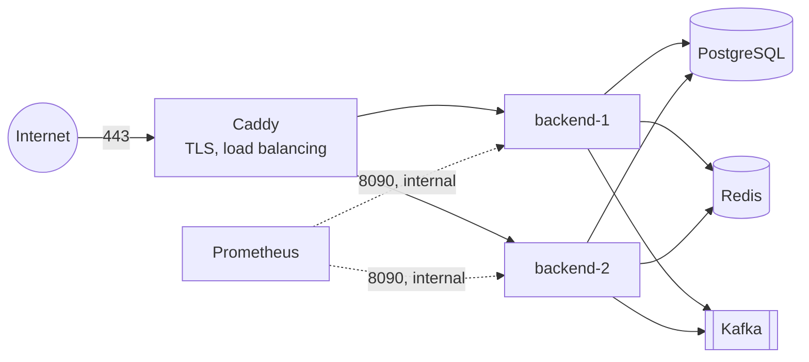

# Deploying RideFlow on one cloud VM

How to run the whole system on a single virtual machine with Docker Compose, behind HTTPS. It suits a
staging environment, a demo with real users, or a first production. The one-command demo in the
[README](../README.md) is not this: it runs the `sim` profile, with rate limits lifted and a mock
gateway that credits any wallet.

> Written for this project, not rehearsed on a cloud account: every setting below is one the
> application reads, but the guide as a whole has not been run end to end on a real VM.

## What you get



- **Public:** only ports 80 and 443, both on Caddy. It obtains and renews a Let's Encrypt certificate
  on its own, and spreads requests and WebSockets over the two backends.
- **Internal:** PostgreSQL, Redis, Kafka, Prometheus and the backends' actuator port, 8090, are on
  the Compose network only.
- **Why Caddy talks to the backends directly:** behind an nginx in between, the backend would see
  nginx's plain-HTTP port and refuse the live map's WebSocket as another site's. Caddy passes
  `X-Forwarded-Proto: https`, which Tomcat believes because Caddy's address is private.

## Sizing

Measured on a laptop with 14 cores ([performance.md](performance.md)): 2,000 drivers streaming
positions used about 4% of its CPU, and a 30-minute soak at 60 bookings a minute stayed near 3%. A
VM with 4 vCPUs and 8 GB of memory runs everything in this guide with room to spare. 16 GB is
needed only if Prometheus keeps months of data.

## 1. The machine

```bash
# Ubuntu 24.04, as a user with sudo
curl -fsSL https://get.docker.com | sh
sudo usermod -aG docker "$USER"            # log out and in again
sudo ufw allow OpenSSH && sudo ufw allow 80,443/tcp && sudo ufw enable
```

Point a DNS name, say `rideflow.example.com`, at the VM before starting Caddy: Let's Encrypt
checks it.

## 2. Secrets

Never in the repository, never in the Compose file. Keep them as files readable only by root, one
file per variable; the applications import the directory as a Spring config tree, as the demo does
([ADR 0018](adr/0018-packaging-and-delivery.md)).

```bash
sudo install -d -m 700 /etc/rideflow/secrets
cd /etc/rideflow/secrets
sudo openssl genpkey -algorithm RSA -pkeyopt rsa_keygen_bits:2048 -out /tmp/key.pem
sudo sh -c 'grep -v -- ----- /tmp/key.pem | tr -d "\n" > RIDEFLOW_RSA_PRIVATE_KEY'
sudo sh -c 'openssl pkey -in /tmp/key.pem -pubout | grep -v -- ----- | tr -d "\n" > RIDEFLOW_RSA_PUBLIC_KEY'
sudo rm /tmp/key.pem
sudo sh -c 'openssl rand -hex 32 | tr -d "\n" > RIDEFLOW_GATEWAY_WEBHOOK_SECRET'
sudo sh -c 'openssl rand -hex 24 | tr -d "\n" > RIDEFLOW_DB_PASSWORD'
sudo sh -c 'openssl rand -hex 16 | tr -d "\n" > RIDEFLOW_ADMIN_PASSWORD'   # the first admin's
sudo chmod 400 *
```

The signing key is the one secret whose loss logs everyone out: back it up with the database.

## 3. Configuration

| Variable | Value |
|---|---|
| `SPRING_PROFILES_ACTIVE` | `prod`: JSON logs, Swagger off, and a refusal to start alongside `sim` |
| `SPRING_CONFIG_IMPORT` | `configtree:/run/rideflow/` (the secrets above) |
| `RIDEFLOW_DB_URL`, `RIDEFLOW_DB_USER` | `jdbc:postgresql://postgres:5432/rideflow`, `rideflow` |
| `RIDEFLOW_REDIS_HOST`, `RIDEFLOW_REDIS_PORT` | `redis`, `6379` |
| `RIDEFLOW_KAFKA_BOOTSTRAP` | `kafka:19092` |
| `RIDEFLOW_JWT_ISSUER` | `https://rideflow.example.com` |
| `RIDEFLOW_ADMIN_PHONE` | the first admin's phone; created on first start, with the password file |
| `RIDEFLOW_OTLP_ENDPOINT`, `RIDEFLOW_TRACE_SAMPLE` | a trace collector, if any; `0.1` samples one request in ten |
| `RIDEFLOW_MANAGEMENT_PORT` | `8090`: actuator, scraped by Prometheus, never published |

Payments: the gateway is a mock, because PROJECT_SPEC section 1 puts a real one out of scope.
- **What `prod` does:** keeps the mock's payment page off. A top-up is still created, but nothing
  can pay it, so it stays PENDING.
- **Until a real `PaymentGateway` replaces the mock:** riders pay cash.

## 4. Compose file

`/opt/rideflow/compose.yml`, next to the repository's `infra/` folder (for the Prometheus and
Grafana configuration):

```yaml
name: rideflow

x-backend: &backend
  image: ghcr.io/ayushraj06-bit/rideflow-backend:phase-11
  restart: unless-stopped
  environment:
    SPRING_PROFILES_ACTIVE: prod
    SPRING_CONFIG_IMPORT: configtree:/run/rideflow/
    RIDEFLOW_DB_URL: jdbc:postgresql://postgres:5432/rideflow
    RIDEFLOW_DB_USER: rideflow
    RIDEFLOW_REDIS_HOST: redis
    RIDEFLOW_KAFKA_BOOTSTRAP: kafka:19092
    RIDEFLOW_JWT_ISSUER: https://rideflow.example.com
    RIDEFLOW_ADMIN_PHONE: "+91XXXXXXXXXX"
  volumes:
    - /etc/rideflow/secrets:/run/rideflow:ro
  # Longer than the application's own shutdown (20 s for requests, 15 s for event listeners);
  # Docker's default is 10 s.
  stop_grace_period: 40s
  depends_on:
    postgres: { condition: service_healthy }
    redis: { condition: service_healthy }
    kafka: { condition: service_healthy }

services:
  caddy:
    image: caddy:2.10
    restart: unless-stopped
    ports: ["80:80", "443:443"]
    volumes:
      - ./Caddyfile:/etc/caddy/Caddyfile:ro
      - caddy-data:/data
  backend-1: *backend
  backend-2: *backend
  postgres:
    image: postgres:17.11-alpine
    restart: unless-stopped
    environment:
      POSTGRES_DB: rideflow
      POSTGRES_USER: rideflow
      POSTGRES_PASSWORD_FILE: /run/rideflow/RIDEFLOW_DB_PASSWORD
    volumes:
      - postgres-data:/var/lib/postgresql/data
      - /etc/rideflow/secrets:/run/rideflow:ro
    healthcheck:
      test: ["CMD-SHELL", "pg_isready -U rideflow"]
      interval: 5s
  redis:
    image: redis:7.4.11-alpine
    restart: unless-stopped
    command: ["redis-server", "--save", "", "--appendonly", "no"]
    healthcheck:
      test: ["CMD", "redis-cli", "ping"]
      interval: 5s
  # kafka, prometheus and grafana: as in infra/docker-compose.yml, without their "ports:" lines.

volumes:
  caddy-data:
  postgres-data:
```

Redis keeps no backups on purpose: positions, offers and quotes are minutes old by nature, and
rebuild themselves from the drivers' next reports and PostgreSQL.

`/opt/rideflow/Caddyfile`:

```
rideflow.example.com {
    reverse_proxy backend-1:8080 backend-2:8080 {
        lb_policy round_robin
        health_uri /readyz
    }
}
```

The images are private: `docker login ghcr.io` with a token that can read packages, then
`docker compose -f /opt/rideflow/compose.yml up -d`.

## 5. Operating it

- **Upgrades:** pin a new tag, then restart one instance at a time, so the other keeps serving.
  - **Commands:** `docker compose up -d --no-deps backend-1`, wait for `/readyz`, then `backend-2`.
  - **In-flight work:** each instance finishes its requests within 20 s of a stop.
  - **Migrations:** Flyway runs them on start. Keep them backward compatible, since for a moment
    the old version runs against the new schema.
- **Backups:** `pg_dump` nightly, copied off the machine, and a restore tried now and then. The
  ledger is the record of everyone's money.
- **Monitoring:** Prometheus loads `infra/prometheus/alerts.yml`, and Grafana its dashboards.
  - **Access:** reach Grafana over an SSH tunnel (`ssh -L 3000:localhost:3000 …`), or behind Caddy
    with a password.
  - **When an alert fires:** [the runbook](runbook.md).
- **Logs:** JSON on standard output, with the trace id in each line. Docker's `local` log driver
  keeps them bounded.

## Kubernetes

[`infra/k8s/`](../infra/k8s/) holds manifests for the backend:
- two replicas with liveness and readiness probes, resource requests and limits
- a disruption budget, and a horizontal autoscaler on CPU
- PostgreSQL, Redis and Kafka assumed managed, outside the cluster

CI checks them against the Kubernetes API schemas with kubeconform. They have not been run on a real
cluster.
